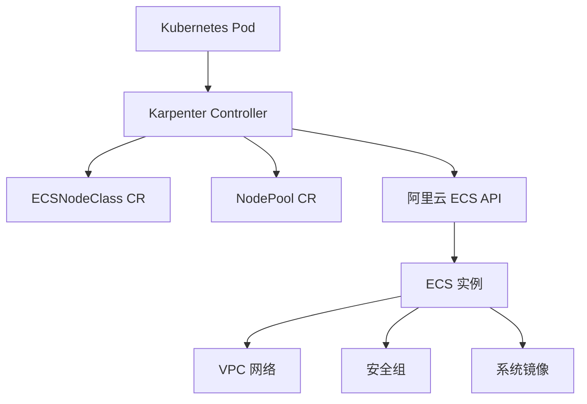
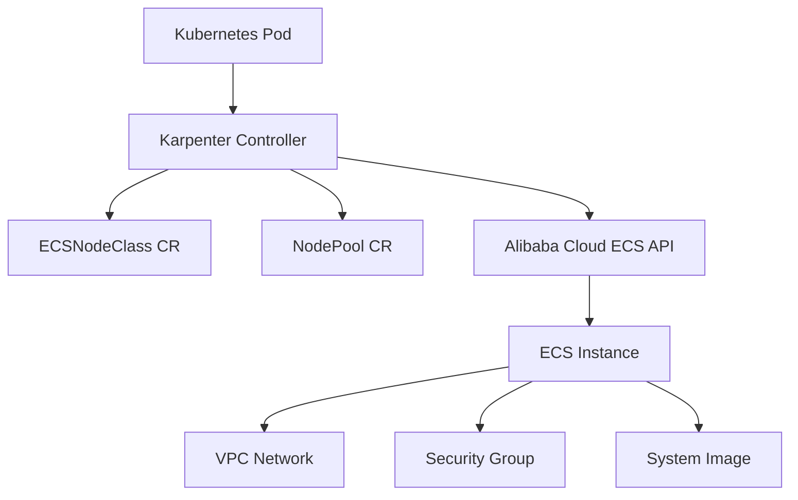

# Alibaba Cloud Karpenter Provider

[项目网站 / Project website](https://rambow-cloud.github.io/karpenter-provider-alibabacloud/) · [English](https://rambow-cloud.github.io/karpenter-provider-alibabacloud/en/)

[NodeClass 状态与镜像筛选规则 / NodeClass readiness and image selectors](ECSNODECLASS_VALIDATION.md)

[节点漂移、缺货反馈与 E2E 镜像发现 / Drift, capacity feedback and E2E images](PROVIDER_BEHAVIOR.md)

[](https://goreportcard.com/report/github.com/AliyunContainerService/karpenter-provider-alibabacloud)
[](https://github.com/AliyunContainerService/karpenter-provider-alibabacloud/blob/main/LICENSE)

[中文](#chinese) | [English](#english)

<a id="chinese"></a>

Alibaba Cloud Karpenter Provider 是一个为 [Karpenter](https://github.com/aws/karpenter) 项目提供的阿里云实现，用于在阿里云上自动管理 Kubernetes 节点。

开发分支已将 Karpenter core 和 AWS 测试依赖固定为 **v1.14.1**，构建需要 **Go 1.26.9**。Chart 为 **0.3.0-dev**，部署时必须指定从当前提交构建的镜像。全新安装、feature gates 配置和待完成的 ACK 发布验收见 [UPGRADING.md](UPGRADING.md)。

最低受支持版本为 **Kubernetes 1.34**，**1.33 及更早版本不受支持**。请选择符合版本要求的集群安装本候选版本。最低支持要求与实测版本分别记录；Helm/离线检查不代表真实 ACK 兼容性验收。详见 [KUBERNETES_SUPPORT.md](KUBERNETES_SUPPORT.md)。

## 功能特性

- **自动扩缩容**: 根据工作负载需求自动创建和删除节点
- **多可用区支持**: 自动在多个可用区间分布节点
- **灵活配置**: 通过 ECSNodeClass 和 NodePool CRD 灵活配置节点属性
- **阿里云原生**: 深度集成阿里云 ECS、VPC、安全组等服务

## 架构图



## 支持功能

### NodeClass 属性支持

| 属性 | 配置 |   |
|------|------|---|
| clusterID | - | ✅ |
| vSwitchSelectorTerms | id | ✅ |
|  | tag | ✅ |
| securityGroupSelectorTerms | id | ✅ |
|  | tag | ✅ |
| imageSelectorTerms | id | ✅ |
|  | imageFamily | ✅ |
| systemDisk | - | ✅ |
| dataDisk | - | ✅ |

### NodePool 属性支持

| 属性 | 配置 |  |
|------|------|----|
| karpenter.sh/capacity-type | 仅支持按量付费 | ✅  |
| node.kubernetes.io/instance-type | 多实例规格 | ✅  |
| topology.kubernetes.io/zone | 多可用区 | ✅  |


## 快速开始

请参考 [快速开始指南](QUICK_START.md) 了解如何部署和使用 Alibaba Cloud Karpenter Provider。

## RRSA 使用指导

RRSA (RAM Roles for Service Accounts) 是阿里云提供的一种安全认证方式，允许 Pod 通过 ServiceAccount 获取临时凭证访问云服务，无需使用长期 AK/SK。

如需使用 RRSA，请参考官方文档：
- [中文文档](https://help.aliyun.com/zh/ack/ack-managed-and-ack-dedicated/user-guide/use-rrsa-to-authorize-pods-to-access-different-cloud-services)
- [English Document](https://www.alibabacloud.com/help/en/cs/user-guide/use-rrsa-to-configure-ram-permissions-for-serviceaccount-to-implement)

### 配置步骤

#### 1. 在集群中启用 RRSA 功能

首先需要在 ACK 集群中启用 RRSA 功能，请参考上述官方文档进行操作。

#### 2. 创建 OIDC 身份提供商的 RAM 角色

创建一个 RAM 角色，并配置 OIDC 身份提供商作为信任实体。

#### 3. 给 RAM 角色授权策略

为 RAM 角色添加以下自定义权限策略：

```json
{
  "Version": "1",
  "Statement": [
    {
      "Effect": "Allow",
      "Action": [
        "cs:DescribeClusterAttachScripts",
        "cs:DescribeClusterNodePools",
        "cs:DescribeClusterNodePoolDetail",
        "cs:DescribeTaskInfo",
        "cs:GetClusterAddonInstance",
		"cs:ListClusterAddonInstances",
        "cs:DescribeClusterDetail",
        "cs:DescribeKubernetesVersionMetadata"
      ],
      "Resource": "*"
    },
    {
      "Effect": "Allow",
      "Action": ["cs:DescribeClusterNodes", "cs:RemoveNodePoolNodes"],
      "Resource": "acs:cs:<region>:<account-id>:cluster/<cluster-id>"
    },
    {
      "Effect": "Allow",
      "Action": [
        "ecs:RunInstances",
        "ecs:DescribeInstances",
        "ecs:DeleteInstances",
        "ecs:TagResources",
        "ecs:CreateLaunchTemplate",
        "ecs:DescribeLaunchTemplates",
        "ecs:DeleteLaunchTemplate",
        "ecs:DescribeInstanceTypeResource",
        "ecs:DescribeImages",
        "ecs:DescribeSecurityGroups",
        "ecs:DescribeCapacityReservations",
        "ecs:DescribePrice",
        "ecs:DescribeInstanceTypes",
        "ecs:DescribeZones"
      ],
      "Resource": "*"
    },
    {
      "Effect": "Allow",
      "Action": "vpc:DescribeVSwitches",
      "Resource": "*"
    },
    {
      "Effect": "Allow",
      "Action": "ram:GetRole",
      "Resource": "*"
    }
  ]
}
```

将策略中的 `<region>`、`<account-id>` 和 `<cluster-id>` 替换为目标 ACK 的值。
ACK 接管节点后会维护原生期望数量，即使关闭自动伸缩也可能补节点。
终止时 controller 先通过 ACK 移除精确的自有节点，等待任务成功后再释放 ECS；
请配置上述集群范围权限。`cs:DescribeTaskInfo` 只支持 `Resource: "*"`。
此终止修复尚待重新进行真实 ACK 验收，详见 #101。

#### 4. 配置 Helm Chart Values

在部署 Karpenter 时，需要在 Helm chart 的 values.yaml 中配置 RRSA 相关的环境变量：

```yaml
controller:
  env:
    # RRSA 配置
    - name: ALIBABA_CLOUD_ROLE_ARN
      value: "acs:ram::<your-account-id>:role/<your-role-name>"
    - name: ALIBABA_CLOUD_OIDC_PROVIDER_ARN
      value: "acs:ram::<your-account-id>:oidc-provider/<your-oidc-provider-id>"
    - name: ALIBABA_CLOUD_OIDC_TOKEN_FILE
      value: "/var/run/secrets/ack.alibabacloud.com/rrsa-tokens/token"
```

其中：
- `ALIBABA_CLOUD_ROLE_ARN`: RAM 角色的 ARN，格式为 `acs:ram::<账号ID>:role/<角色名称>`
- `ALIBABA_CLOUD_OIDC_PROVIDER_ARN`: OIDC 身份提供商的 ARN，格式为 `acs:ram::<账号ID>:oidc-provider/<集群ID>`
- `ALIBABA_CLOUD_OIDC_TOKEN_FILE`: OIDC Token 文件路径，使用默认值即可

## 配置示例

### ECSNodeClass 配置

```yaml
apiVersion: karpenter.alibabacloud.com/v1alpha1
kind: ECSNodeClass
metadata:
  name: default
spec:
  # 集群 ID
  clusterID: ""
  # VSwitch 选择器
  vSwitchSelectorTerms:
    - tags:
        karpenter.sh/discovery: my-cluster
    - id: "vsw-bp1h5w****"
  
  # 安全组选择器
  securityGroupSelectorTerms:
    - tags:
        karpenter.sh/discovery: my-cluster
    - id: "sg-bp1h5w****"
  
  # 镜像选择器
  imageSelectorTerms:
    - imageFamily: "acs:alibaba_cloud_linux_3_2104_lts_x64"
    - id: "aliyun_3_x64_20G_container_optimized_alibase_20250629.vhd"
```

### NodePool 配置

```yaml
apiVersion: karpenter.sh/v1
kind: NodePool
metadata:
  name: default
spec:
  template:
    spec:
      requirements:
        - key: karpenter.sh/capacity-type
          operator: In
          values: ["on-demand"]
        - key: node.kubernetes.io/instance-type
          operator: In
          values: ["ecs.g6.large"]
      nodeClassRef:
        name: default
        group: karpenter.alibabacloud.com
        kind: ECSNodeClass
  limits:
    cpu: "100"
  disruption:
    consolidationPolicy: WhenEmptyOrUnderutilized
    consolidateAfter: 720h
```

## 开发指南

### 构建项目

```bash
make build
```

### 运行测试

```bash
make test
```

### 本地调试

```bash
make run
```

## 贡献

欢迎提交 Issue 和 Pull Request 来改进 Alibaba Cloud Karpenter Provider。

请遵循 [贡献流程](CONTRIBUTING.md)：Issue → `feat/<issue编号>-<说明>` → 填写 PR 模板并关联 Issue。任务见 [Project](https://github.com/orgs/rambow-cloud/projects/4)，版本验收见 [v1.14.1 milestone](https://github.com/rambow-cloud/karpenter-provider-alibabacloud/milestone/1)。

## 许可证

本项目采用 Apache-2.0 许可证。详情请见 [LICENSE](LICENSE) 文件。

---

<a id="english"></a>

## English

Alibaba Cloud Karpenter Provider is an Alibaba Cloud implementation of the [Karpenter](https://github.com/aws/karpenter) project. It automatically manages Kubernetes nodes on Alibaba Cloud.

The development branch pins Karpenter core and the AWS test harness to **v1.14.1** and requires **Go 1.26.9**. The chart is **0.3.0-dev**; deploy an image built from the matching commit. See [UPGRADING.md](UPGRADING.md) for fresh-install configuration and the pending ACK release gate.

The minimum supported version is **Kubernetes 1.34**; **1.33 and earlier are unsupported**. Select a cluster meeting the version requirement for this fresh installation. Minimum requirements and tested versions are recorded separately; Helm/offline checks do not establish real ACK compatibility. See [KUBERNETES_SUPPORT.md](KUBERNETES_SUPPORT.md).

### Features

- **Automatic scaling**: Automatically creates and deletes nodes based on workload requirements
- **Multi-zone support**: Automatically distributes nodes across multiple availability zones
- **Flexible configuration**: Flexibly configures node properties through the ECSNodeClass and NodePool CRDs
- **Alibaba Cloud native**: Deep integration with Alibaba Cloud services such as ECS, VPC, and security groups

### Architecture



### Supported Features

#### NodeClass Property Support

| Property | Configuration |   |
|----------|---------------|---|
| clusterID | - | ✅ |
| vSwitchSelectorTerms | id | ✅ |
|  | tag | ✅ |
| securityGroupSelectorTerms | id | ✅ |
|  | tag | ✅ |
| imageSelectorTerms | id | ✅ |
|  | imageFamily | ✅ |
| systemDisk | - | ✅ |
| dataDisk | - | ✅ |

#### NodePool Property Support

| Property | Configuration |  |
|----------|---------------|--|
| karpenter.sh/capacity-type | On-demand only | ✅ |
| node.kubernetes.io/instance-type | Multiple instance types | ✅ |
| topology.kubernetes.io/zone | Multiple availability zones | ✅ |

### Quick Start

See the [Quick Start Guide](QUICK_START.md) to learn how to deploy and use Alibaba Cloud Karpenter Provider.

### RRSA Guide

RRSA (RAM Roles for Service Accounts) is an Alibaba Cloud authentication method that allows Pods to obtain temporary credentials through a ServiceAccount to access cloud services without using long-term AccessKey credentials.

For information about using RRSA, see the official documentation:
- [Chinese Documentation](https://help.aliyun.com/zh/ack/ack-managed-and-ack-dedicated/user-guide/use-rrsa-to-authorize-pods-to-access-different-cloud-services)
- [English Documentation](https://www.alibabacloud.com/help/en/cs/user-guide/use-rrsa-to-configure-ram-permissions-for-serviceaccount-to-implement)

#### Configuration Steps

##### 1. Enable RRSA on the Cluster

First, enable RRSA on the ACK cluster by following the official documentation above.

##### 2. Create a RAM Role for the OIDC Identity Provider

Create a RAM role and configure the OIDC identity provider as the trusted entity.

##### 3. Grant a Policy to the RAM Role

Attach the following custom permission policy to the RAM role:

```json
{
  "Version": "1",
  "Statement": [
    {
      "Effect": "Allow",
      "Action": [
        "cs:DescribeClusterAttachScripts",
        "cs:DescribeClusterNodePools",
        "cs:DescribeClusterNodePoolDetail",
        "cs:DescribeTaskInfo",
        "cs:GetClusterAddonInstance",
        "cs:DescribeClusterDetail",
        "cs:DescribeKubernetesVersionMetadata"
      ],
      "Resource": "*"
    },
    {
      "Effect": "Allow",
      "Action": ["cs:DescribeClusterNodes", "cs:RemoveNodePoolNodes"],
      "Resource": "acs:cs:<region>:<account-id>:cluster/<cluster-id>"
    },
    {
      "Effect": "Allow",
      "Action": [
        "ecs:RunInstances",
        "ecs:DescribeInstances",
        "ecs:DeleteInstances",
        "ecs:TagResources",
        "ecs:CreateLaunchTemplate",
        "ecs:DescribeLaunchTemplates",
        "ecs:DeleteLaunchTemplate",
        "ecs:DescribeInstanceTypeResource",
        "ecs:DescribeImages",
        "ecs:DescribeSecurityGroups",
        "ecs:DescribeCapacityReservations",
        "ecs:DescribePrice",
        "ecs:DescribeInstanceTypes",
        "ecs:DescribeZones"
      ],
      "Resource": "*"
    },
    {
      "Effect": "Allow",
      "Action": "vpc:DescribeVSwitches",
      "Resource": "*"
    },
    {
      "Effect": "Allow",
      "Action": "ram:GetRole",
      "Resource": "*"
    }
  ]
}
```

Replace `<region>`, `<account-id>` and `<cluster-id>` with the target ACK values.
ACK maintains native desired capacity after adoption even with autoscaling off.
Termination first removes the exact owned native member, waits for the ACK task,
then deletes ECS. Grant the cluster-scoped permissions above; `cs:DescribeTaskInfo`
supports only `Resource: "*"`. Live revalidation of this fix remains open in #101.

##### 4. Configure Helm Chart Values

When deploying Karpenter, configure the RRSA environment variables in the Helm chart's `values.yaml`:

```yaml
controller:
  env:
    # RRSA configuration
    - name: ALIBABA_CLOUD_ROLE_ARN
      value: "acs:ram::<your-account-id>:role/<your-role-name>"
    - name: ALIBABA_CLOUD_OIDC_PROVIDER_ARN
      value: "acs:ram::<your-account-id>:oidc-provider/<your-oidc-provider-id>"
    - name: ALIBABA_CLOUD_OIDC_TOKEN_FILE
      value: "/var/run/secrets/ack.alibabacloud.com/rrsa-tokens/token"
```

Where:
- `ALIBABA_CLOUD_ROLE_ARN`: The ARN of the RAM role, in the format `acs:ram::<account-id>:role/<role-name>`
- `ALIBABA_CLOUD_OIDC_PROVIDER_ARN`: The ARN of the OIDC identity provider, in the format `acs:ram::<account-id>:oidc-provider/<cluster-id>`
- `ALIBABA_CLOUD_OIDC_TOKEN_FILE`: The path to the OIDC token file; use the default value

### Configuration Examples

#### ECSNodeClass Configuration

```yaml
apiVersion: karpenter.alibabacloud.com/v1alpha1
kind: ECSNodeClass
metadata:
  name: default
spec:
  # Cluster ID
  clusterID: ""
  # VSwitch selectors
  vSwitchSelectorTerms:
    - tags:
        karpenter.sh/discovery: my-cluster
    - id: "vsw-bp1h5w****"

  # Security group selectors
  securityGroupSelectorTerms:
    - tags:
        karpenter.sh/discovery: my-cluster
    - id: "sg-bp1h5w****"

  # Image selectors
  imageSelectorTerms:
    - imageFamily: "acs:alibaba_cloud_linux_3_2104_lts_x64"
    - id: "aliyun_3_x64_20G_container_optimized_alibase_20250629.vhd"
```

#### NodePool Configuration

```yaml
apiVersion: karpenter.sh/v1
kind: NodePool
metadata:
  name: default
spec:
  template:
    spec:
      requirements:
        - key: karpenter.sh/capacity-type
          operator: In
          values: ["on-demand"]
        - key: node.kubernetes.io/instance-type
          operator: In
          values: ["ecs.g6.large"]
      nodeClassRef:
        name: default
        group: karpenter.alibabacloud.com
        kind: ECSNodeClass
  limits:
    cpu: "100"
  disruption:
    consolidationPolicy: WhenEmptyOrUnderutilized
    consolidateAfter: 720h
```

### Development Guide

#### Build the Project

```bash
make build
```

#### Run Tests

```bash
make test
```

#### Local Debugging

```bash
make run
```

### Contributing

Issues and pull requests that improve Alibaba Cloud Karpenter Provider are welcome.

Follow [CONTRIBUTING.md](CONTRIBUTING.md): issue → `feat/<issue-number>-<description>` → PR template with a closing reference. Track work in the [project](https://github.com/orgs/rambow-cloud/projects/4) and [compatibility milestone](https://github.com/rambow-cloud/karpenter-provider-alibabacloud/milestone/1).

### License

This project is licensed under the Apache License 2.0. See the [LICENSE](LICENSE) file for details.

## ACK 镜像兼容性 / ACK image compatibility

ACK 公共镜像默认按目标集群区域、实际版本和 containerd 的兼容清单选择，而不是自动采用 ECS 最新镜像。本 provider 当前只支持 Linux；ContainerOS 需要恰好一块显式持久数据盘，暂不支持 ContainerOS + LaunchTemplate。自定义/共享镜像需要 `imageCompatibilityPolicy: Custom` 和精确 ID，由用户验证基础 OS、runtime、架构和启动兼容性。参见 [镜像支持与部署说明](ACK_IMAGE_SUPPORT.md)。

ACK public images are selected from the target cluster's regional, version-specific containerd metadata, then verified through ECS. This provider supports Linux only. ContainerOS requires exactly one explicit persistent data disk; ContainerOS with a launch template is rejected. Custom/shared images require `imageCompatibilityPolicy: Custom` and exact IDs, with provenance/runtime/bootstrap compatibility verified by the user. Add the read-only RAM action `cs:DescribeKubernetesVersionMetadata` before upgrading. Image resolution and read-only API checks do not constitute real ACK lifecycle acceptance.
